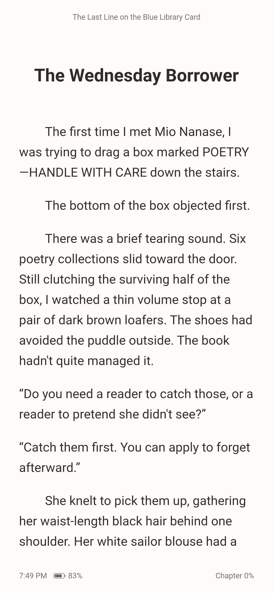

  
  <h1>Shiori</h1>
  
开源轻小说阅读器 · EPUB / TXT · Android / iOS / Windows / macOS

  

    <a href="https://memory1031.github.io/shiori-reader/zh-cn/"><strong>官方网站</strong></a>
    · <a href="https://memory1031.github.io/shiori-reader/zh-cn/download/">下载 Shiori</a>
    · <a href="docs/altstore.md">AltStore 侧载</a>
    · <a href="https://memory1031.github.io/shiori-reader/en/">English</a>
  

---

以**本地阅读为核心**，导入自己的 EPUB 或 TXT，按喜欢的方式排版和翻页。借助全文搜索与书签回顾故事中的细节，查看其他位置后，也能返回原处继续阅读。

除了本地书籍，Shiori 还支持通过 [LightNovel.fun](https://www.lightnovel.fun/) 搜索和阅读在线轻小说。书架、阅读进度、书签和阅读偏好保存在本地，本地阅读无需注册账号或联网。

> **本页以 `develop` 分支的最新功能为准。** GitHub Releases 中的正式安装包可能尚未包含部分新功能，下载前请查看对应版本的[更新说明](https://github.com/Memory1031/shiori-reader/releases)。

## 功能亮点

- **本地书库** — 导入 TXT 和常见的无 DRM 流式 EPUB（2/3），把自己的书放进书架；手机端也可从其他应用打开或分享文件。
- **舒适翻页** — 选择喜欢的翻页效果，调整字号、行距与纸张颜色，搭配浅色或深色主题；宽屏下可双页阅读。
- **搜索与书签** — 在本地书中搜索文字，回顾前后文；为本地或在线书籍保存多处书签，随时重读喜欢的段落。
- **返回原处** — 查看书签、搜索结果或书内链接后，返回原来的阅读位置，继续刚才的故事。
- **随时续读** — 书架可切换网格或列表，记住阅读位置，下次打开接着读。
- **桌面阅读** — Windows 与 macOS 支持拖入文件、键盘和滚轮翻页，宽屏阅读时也能欣赏插图与正文并排的效果。
- **在线阅读** — 通过 [LightNovel.fun](https://www.lightnovel.fun/) 找书、查看分卷目录并阅读；已缓存的内容可离线阅读，缓存也可按需清理。

## 截图

以下为 v1.4.0 正式版真实界面，展示原创演示小说《蓝色借书卡的最后一栏》。应用不附带第三方小说。更多阅读、搜索与书签展示见[官网](https://memory1031.github.io/shiori-reader/zh-cn/#experience)。

### Windows 桌面端

**宽屏双页阅读：插图与正文配对**

### Android 移动端

书架与续读、单页阅读：

  
  

## 安装

| 平台 | 安装方式 |
| --- | --- |
| Android 7.0+ | 从[下载页面](https://github.com/Memory1031/shiori-reader/releases)获取 APK，安装到手机。 |
| iOS 15.0+ | 可通过 Xcode 自行构建安装，或从[下载页面](https://github.com/Memory1031/shiori-reader/releases)获取未签名 IPA，自行签名后安装。IPA 不能直接在 iPhone 上安装，配置见[发布说明](docs/release/README.md#ios-未签名-ipa)。 |
| Windows x64 | 在[下载页面](https://github.com/Memory1031/shiori-reader/releases)获取安装版 EXE（推荐，当前用户安装与正常卸载），或完整解压便携 ZIP 后运行 `shiori.exe`。包未经 Windows 代码签名，可能出现 SmartScreen 提示；部分特殊版式 EPUB 页面需要 WebView2 运行环境。 |
| macOS 12.0+ | 从[下载页面](https://github.com/Memory1031/shiori-reader/releases)获取 macOS DMG，将 Shiori 拖入「应用程序」或其他可写目录；同一安装包支持 Apple Silicon 和 Intel。未使用 Apple 开发者签名或公证，首次打开可能需要在系统「隐私与安全性」中确认。 |

Android 覆盖安装需要签名一致；从 Debug 包切换到正式签名包前，请先保全数据。版本、签名与分发方式见[发布说明](docs/release/README.md)。

iOS 未签名 IPA 不含可直接使用的开发者签名，签名与后续更新由用户自行处理。应用内 EPUB / TXT 导入不依赖 App Group 授权；系统分享扩展则需要匹配的签名与 App Group。更改 Bundle ID、卸载或更换签名方式可能影响原有数据，请先保全。

从本仓库发布的 Android / Windows / macOS 安装包可在「关于与更新」检查更新。Windows 安装版与便携版均支持后续应用内更新；便携 ZIP 应完整解压到可写目录，不要只复制 EXE；macOS 请先将应用复制到可写目录，再使用应用内更新，不要直接在 DMG 中运行。v1.4.0 使用旧更新协议，升级至 v1.4.1 需手动安装一次。

## 快速开始

1. **添加书籍**：通过「更多 → 导入」选择 TXT / EPUB，或从其他应用打开、分享文件到手机端 Shiori，确认后导入；在线找书可点击首页搜索。
2. **开始阅读**：点击书架上的书籍继续阅读；网格模式长按、列表模式左滑，可查看详情或移除。
3. **调整阅读体验**：点击正文中部唤起工具栏，通过目录跳转、调整进度或修改排版；点按两侧或左右拖动翻页。
4. **查找与重读**：顶部放大镜可搜索本地书正文；更多菜单可添加书签，通过「我的书签」查看或删除。首页搜索用于在线找书，与本书全文搜索分开。
5. **返回原处**：查阅后点击短暂出现的返回按钮，或从阅读器更多菜单返回原来的阅读位置。

## 使用说明

### 桌面操作

桌面端通过导航栏切换页面，使用「导入书籍」按钮或拖入文件添加本地书；书籍右键 / 更多菜单提供详情等操作，键盘可用 Menu 键或 Shift+F10 打开菜单。阅读时按 F2 显示 / 隐藏工具栏，Ctrl+F 搜索本地书正文（macOS 使用 ⌘F，部分键盘需按 Fn+F2）。macOS 也可通过系统「打开方式」接收文件，或按 ⌘O 选择书籍。

### 数据清理

导入文件会保存为应用内副本。书籍移除需要确认，且不提供撤销：

| 操作 | 数据影响 |
| --- | --- |
| 移除本地书籍 | 删除导入副本、应用为它生成的内容、阅读进度和书签；不影响外部原文件。 |
| 从书架或详情移出在线书籍 | 移出书架，同时清除该书缓存、阅读进度和书签。 |
| 单独清理缓存 | 保留书架、阅读进度、书签和本地导入文件。为节省空间，部分缓存也可能被自动清理。 |
| 单独清除阅读历史 | 删除该书阅读进度，保留书架、书签和缓存。 |

### 更新旧书排版

应用升级后，会在合适时机尝试更新旧书的排版处理；正在阅读的书稍后处理。如果无法准确保留阅读位置，或需要确认文字编码，就先保留原来的内容。若想立即应用新的排版修复，可进入「设置 → 本地文件 → 书籍菜单 → 重新解析」，完成后重新打开；无需删除重导。

桌面端可直接进入「本地文件」，或在书架本地书菜单中选择「重新解析」。

### 支持范围

目前不支持带 DRM 保护的书籍、PDF、完整固定版式 EPUB、云同步或整本在线下载。EPUB 以普通图文书籍为主，部分复杂版式可能与原书不同，具体范围见[本地导入](docs/local-import.md)。

「搜索本书」和「重新解析」仅适用于导入的 EPUB / TXT，不提供在线全书搜索。书签适用于普通正文，部分特殊版式页和临时打开的附页不支持添加。在线书可切换卷内目录和分卷目录，本地 EPUB 按书中的目录阅读，TXT 按识别出的章节阅读。

在线功能目前接入 [LightNovel.fun](https://www.lightnovel.fun/)，其服务可用性可能变化。应用不附带小说内容，也不提供个性化推荐服务。

## 开发与贡献

Shiori 使用 Flutter 开发。想自行构建或参与贡献，请从[开发说明](docs/development.md)开始；环境准备、构建命令和测试方法统一维护在那里。

## 项目文档

| 文档 | 内容 |
| --- | --- |
| [文档导航](docs/README.md) | 架构、模块与维护文档入口 |
| [阅读器](docs/reader.md) / [本地导入](docs/local-import.md) | 阅读行为、格式兼容与使用限制 |
| [开发说明](docs/development.md) | 环境准备、运行、测试与排障 |
| [持续集成](docs/ci.md) / [发布说明](docs/release/README.md) | 质量检查、签名和版本发布 |

## 问题反馈

可通过 [Issues](https://github.com/Memory1031/shiori-reader/issues) 反馈问题。请注明应用版本、设备与系统版本、复现步骤、预期和实际表现，必要时附截图。

EPUB 兼容性问题请尽量提供最小可复现样本或结构说明；不要上传签名密钥、密码、个人数据或无权分享的完整书籍。

## 隐私与许可

书架、进度、书签、偏好和导入文件由应用在本地保存；在线查询与媒体请求会访问书源服务，检查或下载更新会访问本项目的 GitHub Releases 及其下载服务。系统备份或换机迁移可能包含用户数据，详见[隐私与分发说明](docs/release/dependencies.md#许可与隐私边界)。

Shiori 是非官方第三方客户端，与 LightNovel.fun 及其运营方无关联，也未获得其官方认可。Shiori 不附带小说内容，也不提供绕过认证、访问控制、付费机制或 DRM 的功能。在线内容由相应第三方服务提供，相关内容与商标权利归各自权利人所有；第三方 API 或页面变化可能使在线功能暂时不可用。

本项目源码以 [MIT License](LICENSE) 授权。该许可不授予 Shiori 名称、Logo、应用图标等品牌素材，也不授予第三方小说内容、第三方商标、LightNovel.fun 的名称 / 服务 / 内容及其他第三方资产的任何权利；依赖许可清单见[发布文档](docs/release/dependencies.md)。
