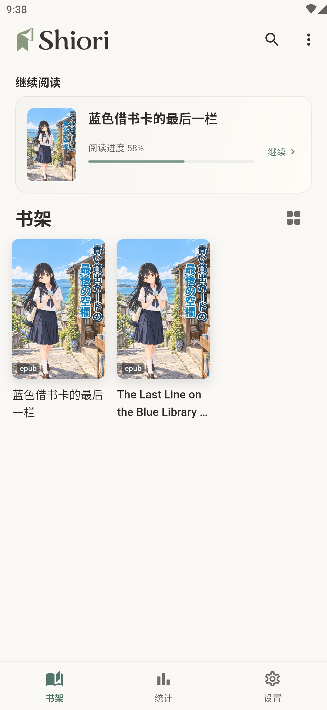
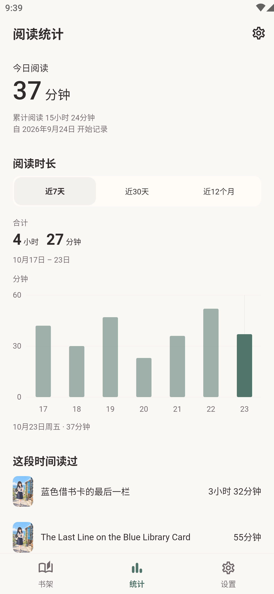

  
  <h1>Shiori</h1>
  
开源轻小说阅读器 · EPUB / TXT · Android / iOS / Windows / macOS

  

    <a href="https://memory1031.github.io/shiori-reader/zh-cn/download/"><strong>下载 Shiori</strong></a>
    · <a href="https://memory1031.github.io/shiori-reader/zh-cn/">官方网站</a>
    · <a href="docs/altstore.md">AltStore 侧载</a>
    · <a href="https://memory1031.github.io/shiori-reader/en/">English</a>
  

Shiori 是一款以本地阅读为核心的开源轻小说阅读器。导入 EPUB 或 TXT，按自己的习惯调整排版，在手机上单页翻阅，在宽屏上双页阅读。

书籍、进度、书签和阅读统计保存在本机，本地阅读无需账号或网络。各设备独立保存书库和记录，目前没有云同步。

## 下载与安装

| 平台 | 下载入口 |
| --- | --- |
| Android 7.0+ | [APK](https://github.com/Memory1031/shiori-reader/releases/latest) |
| iOS / iPadOS 15.0+ | [未签名 IPA](https://github.com/Memory1031/shiori-reader/releases/latest)，需自行签名；也可使用 [AltStore Classic 订阅源](docs/altstore.md) |
| Windows x64 | [安装版 EXE（推荐）/ 便携 ZIP](https://github.com/Memory1031/shiori-reader/releases/latest) |
| macOS 12.0+ | [通用 DMG](https://github.com/Memory1031/shiori-reader/releases/latest)，支持 Apple Silicon / Intel |

[查看全部版本与更新说明](https://github.com/Memory1031/shiori-reader/releases) · [完整安装与签名说明](docs/release/README.md)

安装提示与后续更新

- **Android**：打开 APK，按系统提示安装。覆盖安装需要相同签名，从 Debug 包切换到正式签名包前，请先备份数据。
- **Windows**：推荐使用 EXE 安装版，支持当前用户安装和系统卸载。便携版需完整解压到可写目录后运行 `shiori.exe`。安装包未经 Windows 代码签名，可能出现 SmartScreen 提示；部分特殊版式 EPUB 页面需要 WebView2。
- **macOS**：将 Shiori 从 DMG 拖入「应用程序」或其他可写目录，再运行和更新。应用未经 Apple 开发者签名或公证，首次打开可能需要在系统「隐私与安全性」中确认。
- **iOS**：通过自选工具签名安装 IPA，或使用 Xcode 自行构建。官方直接分发版可在应用内检查新版和查看说明，再通过原签名方式更新；TestFlight 版本继续在 TestFlight 更新。应用内导入 EPUB / TXT 不依赖 App Group；系统分享扩展还需要匹配的签名和 App Group 授权。更改 Bundle ID、卸载或更换签名方式前，请先备份数据。

本仓库发布的 Android、Windows 和 macOS 安装包可在「关于与更新」检查新版。Windows 安装版和便携版均支持应用内更新。v1.4.0 用户升级新版需手动安装一次。

## 阅读体验

**Android · 阅读器、书架与阅读统计**（统计为演示数据）

  
  
  

- **按习惯排版**：调整字体、字号、行距、页边距与阅读主题，选择仿真、覆盖、平移或无动画翻页。
- **找回想读的段落**：搜索本地书籍全文、保存多处书签；查阅目录、搜索结果或书内链接后，可返回原来的阅读位置。
- **整理自己的书库**：导入常见的无 DRM 流式 EPUB 2/3 和 TXT，管理书架并继续阅读。移动端可从其他应用打开或分享文件，桌面端支持文件拖入。
- **回顾阅读时长**：查看今天、累计以及近 7 天、30 天、12 个月的阅读情况，支持分书统计、暂停记录和清空。
- **在线找书**：通过 [LightNovel.fun](https://www.lightnovel.fun/) 搜索和阅读轻小说，使用分卷目录；已缓存的章节和资源可离线阅读。

**Windows · 插图与正文双页阅读**

截图展示原创演示小说《蓝色借书卡的最后一栏》，阅读统计使用演示数据。更多界面见[官网](https://memory1031.github.io/shiori-reader/zh-cn/#experience)。本页与截图基于 `develop` 分支，正式安装包包含的功能以对应版本的[更新说明](https://github.com/Memory1031/shiori-reader/releases)为准。

## 从一本书开始

1. **导入书籍**：手机端在「更多 → 导入书籍」选择 EPUB / TXT，或从其他应用打开、分享文件到 Shiori，确认后导入。桌面端可点击「导入书籍」或拖入文件。
2. **开始阅读**：点击书架上的书籍。点按正文两侧或左右拖动翻页，点按中间显示或隐藏工具栏。
3. **调整排版**：从阅读工具栏打开设置，调整字体、字号、行距、页边距和阅读配色。
4. **查找与重读**：顶部放大镜用于搜索本地书正文；更多菜单可添加书签、打开「我的书签」。查阅后，通过返回按钮或更多菜单回到原来的阅读位置。首页搜索用于在线找书。

手机端管理书籍时，网格模式长按、列表模式左滑，可查看详情或移除。

桌面操作与快捷键

| 操作 | 快捷方式 |
| --- | --- |
| 前后翻页 | 左右方向键、PageUp / PageDown 或鼠标滚轮 |
| 显示或隐藏阅读工具栏 | F2；部分 Mac 键盘需按 Fn+F2 |
| 搜索本地书正文 | Windows：Ctrl+F；macOS：⌘F |
| 导入书籍 | 点击「导入书籍」或拖入文件；macOS 还支持 ⌘O 和系统「打开方式」 |
| 打开书籍菜单 | 右键、更多按钮，或用 Menu / Shift+F10 |
| 关闭阅读弹层或图片预览 | Esc |

升级后应用新的书籍排版

应用升级后会自动尝试更新旧书排版，正在阅读的书稍后处理。无法准确保留阅读位置，或需要确认 TXT 编码时，会保留原内容。

立即应用排版修复：进入「设置 → 本地文件 → 书籍菜单 → 重新解析」，完成后重新打开书籍，无需删除重导。桌面端可直接进入「本地文件」，或使用书架本地书菜单中的「重新解析」。

删除书籍、清理缓存与阅读记录

导入时会保存应用内副本。删除或移除书籍需确认，操作无法撤销：

| 操作 | 数据影响 |
| --- | --- |
| 删除本地书籍 | 删除应用内副本、解析内容、阅读进度和书签；外部原文件保留。 |
| 移出在线书籍 | 移出书架，并清除该书缓存、阅读进度和书签。 |
| 清理缓存 | 保留书架、进度、书签、阅读统计和本地导入文件。部分缓存也可能被自动清理以释放空间。 |
| 清除阅读历史 | 删除该书进度，保留书架、书签、缓存和阅读统计。 |

移除书籍后，分书统计不再关联书名，每日合计时长保留。统计不自动过期；在「统计 → 管理记录」中清空，不影响书架、进度和书签，也不改变记录开关。

## 格式与功能支持

支持常见的无 DRM 流式 EPUB 2/3 和 TXT。复杂 EPUB 排版可能与原书不同；PDF、完整固定版式 EPUB、DRM 保护书籍和整本在线下载暂不支持。格式兼容范围见[本地导入](docs/local-import.md#解析支持矩阵)。

全文搜索和重新解析适用于本地导入的 EPUB / TXT。书签适用于普通正文，部分特殊版式页和临时附页不支持添加。在线书可使用卷内和分卷目录，本地 EPUB 使用原书目录，TXT 使用识别出的章节。

## 文档与贡献

Shiori 使用 Flutter 开发。自行构建或参与贡献，请从[开发说明](docs/development.md)开始。

| 你想了解 | 文档 |
| --- | --- |
| 阅读操作、排版与书籍导入 | [阅读器](docs/reader.md) · [本地导入](docs/local-import.md) |
| 环境准备、运行与测试 | [开发说明](docs/development.md) · [测试策略](docs/testing.md) |
| 架构、接口与模块约定 | [文档导航](docs/README.md) |
| 构建检查、版本与签名 | [持续集成](docs/ci.md) · [发布说明](docs/release/README.md) |

通过 [GitHub Issues](https://github.com/Memory1031/shiori-reader/issues) 反馈问题，请附应用版本、设备和系统版本、复现步骤、预期与实际表现，必要时附截图。EPUB 兼容性问题请提供有权分享的最小样本或结构说明；不要上传密码、签名密钥、个人数据或无权分享的完整书籍。

## 隐私与许可

书架、进度、书签、阅读统计、偏好和导入文件保存在本机。在线查询与媒体请求访问书源服务，检查和下载更新访问本项目的 GitHub Releases 及其下载服务。系统备份或换机迁移可能包含用户数据，详见[隐私说明](docs/release/dependencies.md#许可与隐私边界)。

Shiori 不附带第三方小说，与 LightNovel.fun 及其运营方无关联，也未获其官方认可。不提供绕过认证、访问控制、付费机制或 DRM 的功能；在线内容与商标归各自权利人所有，第三方服务变化可能影响在线功能。

源码以 [MIT License](LICENSE) 授权。Shiori 名称、Logo、应用图标等品牌素材，以及第三方内容、服务、商标和其他资产的权利不随该许可授予。依赖许可清单见[发布文档](docs/release/dependencies.md)。
