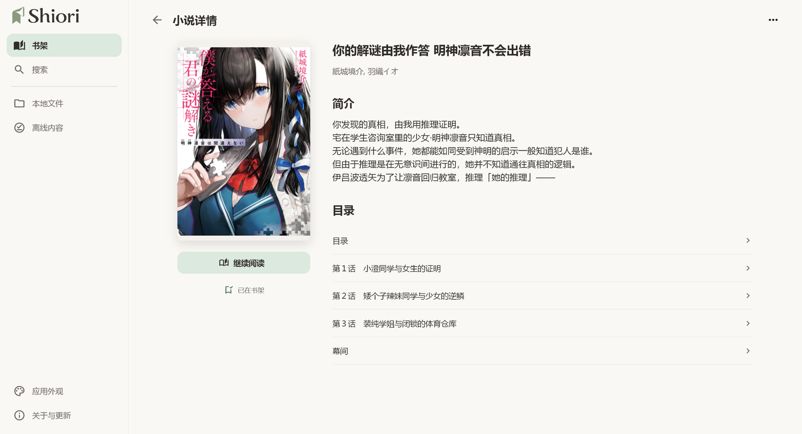

  
  <h1>Shiori</h1>
  
把喜欢的故事，留在手边。

  
面向 Android、iOS 与 Windows 的开源轻小说阅读器 · 本地 EPUB / TXT · 可选在线书源 · 中文 / English

  

    <a href="#功能亮点">功能</a> ·
    <a href="#截图">截图</a> ·
    <a href="#安装">安装</a> ·
    <a href="#快速开始">使用</a> ·
    <a href="docs/development.md">开发文档</a>
  

---

Shiori 以本地 EPUB / TXT 阅读为核心：导入自己的书籍，翻页阅读、搜索全文、保存多处书签，查阅后回到原来的位置。也可通过在线书源搜索和阅读轻小说，已缓存内容可离线阅读。书架、阅读进度、书签和排版偏好由应用在本地保存。

> 本页介绍当前开发版本的功能，下载安装包前请查看对应的[版本说明](https://github.com/Memory1031/shiori-reader/releases)。不同设备与系统版本的兼容情况可能有所差异。

## 功能亮点

- **本地书库** — 导入 TXT 和无 DRM 的 EPUB 2/3，手机端也可从其他应用打开或分享文件；重复导入同一个文件不会多出一本书。
- **全书搜索** — 在本地 EPUB / TXT 中搜索文字，查看前后文并跳到对应位置，普通正文中的匹配文字会标亮。
- **多处书签** — 为同一本书保存多个阅读位置，随时查看、跳转或删除；本地和在线书籍都支持，清缓存或阅读历史不会删除书签。
- **查阅回跳** — 通过书签、搜索结果或书内链接查看别处后，可以返回原来的阅读位置；连续查看多个搜索结果或书签时，会记住开始查阅的位置。EPUB 也支持打开脚注和书中附页。
- **舒适翻页** — 点按、左右拖动翻页，可选仿真、覆盖、平移或无动画；宽屏自动双页，插图可与文字并排阅读，纯图片章节和部分特殊版式页单独展示。
- **随时续读** — 书架可在网格和列表间切换，重新打开书籍后接着上次的位置阅读。
- **重新解析** — 旧书可应用新的排版兼容改进，无需删除重导；位置只能大致恢复时会提示。
- **桌面阅读** — Windows 支持拖入文件、键盘 / 滚轮翻页，以及书架、搜索、本地文件等页面切换；阅读器全窗口打开，退出后回到原页面。
- **在线阅读** — 接入 [LightNovel.fun](https://www.lightnovel.fun/) 书源，支持搜索书籍、查看详情与分卷目录、图文阅读及已缓存内容离线阅读。
- **个性排版** — 设置字号、行距、段距、页边距与纸张颜色，支持注音和插图；阅读器菜单随纸张颜色及明暗模式调整。
- **多彩主题** — 浅色、深色、跟随系统，多种强调色，中文与英文界面。
- **离线缓存** — 阅读在线书时缓存已加载内容，可预先缓存选定的下一章；按书或统一清理缓存，释放空间。

「搜索本书」和「重新解析」仅适用于导入的 EPUB / TXT，不提供在线全书搜索。书签适用于普通正文，部分特殊版式页和临时打开的附页不支持添加。在线书可切换卷内目录和分卷目录，本地 EPUB 按书中的目录阅读，TXT 按识别出的章节阅读。

## 截图

以下为已有版本的界面示例，菜单和功能可能与新版本略有不同。图中书籍由用户自行导入，应用不附带这些作品。

### Windows 桌面端

**桌面书架**

**宽屏双页阅读：插图与正文配对**

**小说详情与目录**

### Android 移动端

书架与续读、单页阅读：

  
  

## 安装

| 平台 | 安装方式 |
| --- | --- |
| Android 7.0+ | 从[下载页面](https://github.com/Memory1031/shiori-reader/releases)获取 APK，安装到手机。 |
| iOS 15.0+ | 当前通过 macOS / Xcode 使用自己的开发者签名安装，配置见[开发说明](docs/development.md)。 |
| Windows x64 | 在[下载页面](https://github.com/Memory1031/shiori-reader/releases)获取 Windows 压缩包，完整解压后运行 `shiori.exe`。当前为未签名便携包；部分特殊版式 EPUB 页面需要 WebView2 运行环境。 |

Android 覆盖安装需要签名一致；从 Debug 包切换到正式签名包前，请先保全数据。版本、签名与分发方式见[发布说明](docs/release/README.md)。

从本仓库发布的 Android / Windows 安装包可在「关于与更新」检查更新；iOS 安装与 TestFlight 分发方式见发布说明。Windows 压缩包应完整解压到可写目录，不要只复制 EXE。

## 快速开始

1. **添加书籍**：点击首页搜索查找在线书籍，或通过「更多 → 导入」选择 TXT / EPUB；手机端从其他应用打开或分享文件后，在 Shiori 内确认导入。
2. **开始阅读**：点击书架上的书籍继续阅读；网格模式长按、列表模式左滑，可查看详情或移除。
3. **调整阅读体验**：点击正文中部唤起工具栏，通过目录跳转、调整进度或修改排版；点按两侧或左右拖动翻页。
4. **保存书签**：在阅读器更多菜单选择「添加书签／取消书签」，通过「我的书签」查看、跳转或删除。查阅后点击左上角回转箭头，或从更多菜单返回，继续原处阅读。
5. **搜索本书**：阅读本地 EPUB / TXT 时点击顶部放大镜，输入文字并提交，再选择结果跳转；Windows 也可按 Ctrl+F。首页搜索用于在线找书，与本书全文搜索分开。

桌面端通过导航栏切换工作区，使用「导入书籍」按钮或拖入文件添加本地书；书籍右键 / 更多菜单提供详情等操作，键盘可用 Menu 键或 Shift+F10 打开菜单。阅读时按 F2 显示 / 隐藏工具栏。

导入文件会保存为应用内副本。书籍移除需要确认，且不提供撤销：

| 操作 | 数据影响 |
| --- | --- |
| 移除本地书籍 | 删除导入副本、应用为它生成的内容、阅读进度和书签；不影响外部原文件。 |
| 从书架或详情移出在线书籍 | 移出书架，同时清除该书缓存、阅读进度和书签。 |
| 单独清理缓存 | 保留书架、阅读进度、书签和本地导入文件。为节省空间，部分缓存也可能被自动清理。 |
| 单独清除阅读历史 | 删除该书阅读进度，保留书架、书签和缓存。 |

### 更新旧书排版

应用升级后，会在合适时机尝试更新旧书的排版处理；正在阅读的书稍后处理。如果无法准确保留阅读位置，或需要确认文字编码，就先保留原来的内容。若想立即应用新的排版修复，可进入「更多 → 本地文件 → 书籍菜单 → 重新解析」，完成后重新打开；无需删除重导。

桌面端可直接进入「本地文件」，或在书架本地书菜单中选择「重新解析」。

### 支持范围

目前不支持带 DRM 保护的书籍、PDF、完整固定版式 EPUB、云同步或整本在线下载。EPUB 以普通图文书籍为主，部分复杂版式可能与原书不同，具体范围见[本地导入](docs/local-import.md)。

在线功能目前接入 [LightNovel.fun](https://www.lightnovel.fun/)，其服务可用性可能变化。应用不附带小说内容，也不提供发现或推荐流。

## 开发与贡献

Shiori 使用 Flutter 开发。想自行构建或参与贡献，请从[开发说明](docs/development.md)开始；环境准备、构建命令和测试方法统一维护在那里。

## 项目文档

| 文档 | 内容 |
| --- | --- |
| [文档导航](docs/README.md) | 架构、模块与维护文档入口 |
| [阅读器](docs/reader.md) / [本地导入](docs/local-import.md) | 阅读行为、格式兼容与使用限制 |
| [开发说明](docs/development.md) | 环境准备、运行、测试与排障 |
| [持续集成](docs/ci.md) / [发布说明](docs/release/README.md) | 质量检查、签名和版本发布 |

## 问题反馈

可通过 [Issues](https://github.com/Memory1031/shiori-reader/issues) 反馈问题。请注明应用版本、设备与系统版本、复现步骤、预期和实际表现，必要时附截图。

EPUB 兼容性问题请尽量提供最小可复现样本或结构说明；不要上传签名密钥、密码、个人数据或无权分享的完整书籍。

## 隐私与许可

书架、进度、书签、偏好和导入文件由应用在本地保存；在线查询与媒体请求会访问书源服务，检查或下载更新会访问本项目的 GitHub Releases 及其下载服务。系统备份或换机迁移可能包含用户数据，详见[隐私与分发说明](docs/release/dependencies.md#许可与隐私边界)。

Shiori 是非官方第三方客户端，与 LightNovel.fun 及其运营方无关联，也未获得其官方认可。Shiori 不附带小说内容，也不提供绕过认证、访问控制、付费机制或 DRM 的功能。在线内容由相应第三方服务提供，相关内容与商标权利归各自权利人所有；第三方 API 或页面变化可能使在线功能暂时不可用。

本项目源码以 [MIT License](LICENSE) 授权。该许可不授予 Shiori 名称、Logo、应用图标等品牌素材，也不授予第三方小说内容、第三方商标、LightNovel.fun 的名称 / 服务 / 内容及其他第三方资产的任何权利；依赖许可清单见[发布文档](docs/release/dependencies.md)。
