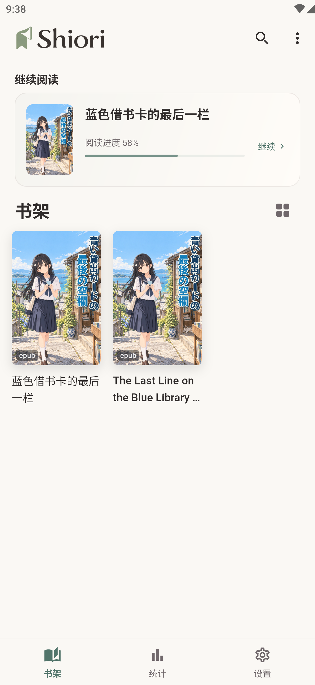

  
  <h1>Shiori</h1>
  
开源轻小说阅读器 · EPUB / TXT · Android / iOS / Windows / macOS

  

    <a href="https://memory1031.github.io/shiori-reader/zh-cn/download/"><strong>下载 Shiori</strong></a>
    · <a href="https://memory1031.github.io/shiori-reader/zh-cn/">官方网站</a>
    · <a href="docs/altstore.md">AltStore 侧载</a>
    · <a href="https://memory1031.github.io/shiori-reader/en/">English</a>
  

Shiori 是一款本地优先、无账号无广告的开源轻小说阅读器。导入无 DRM 的 EPUB 2/3 或 TXT，还原插图、注音、脚注与原书版式；手机单页翻阅，宽屏双页展开。

书库、阅读进度、书签与阅读统计全部保存在本机，离线即可使用。

## 下载与安装

| 平台 | 下载入口 |
| --- | --- |
| Android 7.0+ | [APK](https://github.com/Memory1031/shiori-reader/releases/latest) |
| iOS / iPadOS 15.0+ | [未签名 IPA](https://github.com/Memory1031/shiori-reader/releases/latest)，需自行签名；也可使用 [AltStore Classic 订阅源](docs/altstore.md) |
| Windows x64 | [安装版 EXE（推荐）/ 便携 ZIP](https://github.com/Memory1031/shiori-reader/releases/latest) |
| macOS 12.0+ | [通用 DMG](https://github.com/Memory1031/shiori-reader/releases/latest)，支持 Apple Silicon / Intel |

[查看全部版本与更新说明](https://github.com/Memory1031/shiori-reader/releases) · [完整安装与签名说明](docs/release/README.md)

安装提示与后续更新

- **Android**：打开 APK，按系统提示安装。覆盖安装需要相同签名；从 Debug 包切换到正式签名包前，请先备份数据。
- **Windows**：推荐使用 EXE 安装版，默认安装至当前用户目录，支持开始菜单快捷方式和系统卸载。便携版需完整解压到可写目录后运行 `shiori.exe`。安装包未经 Authenticode 代码签名，可能出现 SmartScreen 提示；部分特殊版式 EPUB 页面需要系统具备 Microsoft WebView2 Runtime。
- **macOS**：将 Shiori 从 DMG 拖入「应用程序」或其他可写目录后再运行和更新，请勿在 DMG 内直接启动。应用未经 Apple Developer ID 签名与公证，首次打开可能需要在系统「隐私与安全性」中确认。
- **iOS**：通过 AltStore Classic 或其他签名工具安装 IPA，或使用 Xcode 自行构建。官方直接分发版可在应用内检查新版并查看更新说明，安装仍通过原签名方式完成；TestFlight 版本通过 TestFlight 更新。应用内导入 EPUB / TXT 不依赖 App Group；系统分享扩展需要主应用与扩展具备匹配的签名和 App Group 授权。更改 Bundle ID、卸载或更换签名方式前，请先备份数据。

本仓库发布的 Android、Windows（安装版与便携版）和 macOS 正式包均可在「设置 → 关于与更新」（桌面端侧边栏「关于与更新」）检查并安装新版。v1.4.0 用户升级新版需手动安装一次。

## 阅读体验

**Android · 阅读器、书架与阅读统计**（统计为演示数据）

  
  
  

- **轻小说排版与插图**：还原常见流式 EPUB 的插图、注音（Ruby）、上标注释、脚注弹层与行内强调线；支持点击插图双击放大、黑白线稿自动融入纸色，以及字体、字号、行距、左右边距和纸白 / 暖纸 / 夜间主题调节。
- **跨端翻页与自适应布局**：提供仿真、覆盖、平移与无动画翻页；界面按窗口宽度在底部导航、图标栏与侧边栏之间自动切换，桌面窄窗同样顺手。
- **省心的本地导入与管理**：导入 TXT 自动识别 UTF-8、UTF-16 与 GB18030 / GBK 编码，兼容异常控制字符并智能整理空行；支持无封面书衣生成、批量管理，以及已导入 TXT 的「文字显示异常」预览恢复。
- **检索、书签与阅读统计**：本地书支持全文搜索与多处书签，查阅目录、搜索结果或书内链接后可一键返回原阅读位置；内置本机阅读统计，按近 7 天、30 天、12 个月及分书汇总，可随时暂停或清空。
- **可选在线阅读**：通过 [LightNovel.fun](https://www.lightnovel.fun/) 搜索与分卷阅读轻小说；已缓存章节和插图可离线阅读，并按书籍管理缓存容量。

**Windows · 插图与正文双页阅读**

截图展示原创演示小说《蓝色借书卡的最后一栏》，阅读统计使用演示数据。更多界面见[官网](https://memory1031.github.io/shiori-reader/zh-cn/#experience)。本页与截图基于 `develop` 分支，各正式包实际包含的功能以对应版本的[更新说明](https://github.com/Memory1031/shiori-reader/releases)为准。

## 快速上手

1. **导入书籍**：手机端在书架右上角「更多 → 导入书籍」或空书架入口选择 EPUB / TXT，也可从其他应用打开或分享文件到 Shiori；桌面端点击「导入书籍」或直接拖入文件。
2. **阅读与翻页**：点击书架书籍进入阅读。点按正文两侧或左右滑动翻页，点按中间显示或隐藏工具栏；点击插图可双击放大查看细节。
3. **调整排版**：在阅读工具栏调整字体、字号、行距、左右边距与阅读主题；在「设置」中可直接通过实时预览切换应用明暗主题。
4. **搜索与书签**：阅读页顶部放大镜用于本地书全文搜索，菜单可添加或打开「我的书签」；查阅后通过返回入口回到原阅读位置。首页搜索用于在线找书。

手机端管理书架时，网格模式长按、列表模式左滑，可查看详情或移除书籍。

桌面操作与快捷键

| 操作 | 快捷方式 |
| --- | --- |
| 前后翻页 | 左右方向键、PageUp / PageDown 或鼠标滚轮 |
| 显示或隐藏阅读工具栏 | F2；部分 Mac 键盘需按 Fn+F2 |
| 搜索本地书正文 | Windows：Ctrl+F；macOS：⌘F |
| 导入书籍 | 点击「导入书籍」或拖入文件；macOS 还支持 ⌘O 和系统「打开方式」 |
| 打开书籍菜单 | 右键、更多按钮，或按 Menu / Shift+F10 |
| 关闭阅读弹层或图片预览 | Esc |

升级后应用新排版与修复 TXT 显示

应用升级后会在条件安全时自动更新旧书的解析记录，正在阅读的书稍后处理。若无法安全迁移阅读位置，会保留原有内容。

- **手动重新解析**：进入「设置 → 本地文件」（桌面端侧边栏「本地文件」），打开该书菜单选择「重新解析」，完成后重新打开即可，无需删除重导。
- **修复 TXT 乱码**：在「本地文件」打开对应 TXT 的菜单，选择「文字显示异常 → 查看文字预览」，挑选显示正常的一项（或展开「高级选项」尝试其他编码）即可更新，并尽量保留阅读位置。

删除书籍、清理缓存与阅读记录

导入本地书籍时会保存应用内副本。删除或移除操作需确认且不可撤销：

| 操作 | 数据影响 |
| --- | --- |
| 删除本地书籍 | 删除应用内副本、解析内容、阅读进度和书签；设备上的外部原文件不受影响。 |
| 移出在线书籍 | 移出书架，并清除该书缓存、阅读进度和书签。 |
| 清理缓存 | 仅清理在线缓存，保留书架、进度、书签、阅读统计和本地导入文件。部分缓存也可能被自动清理以释放空间。 |
| 清除阅读历史 | 删除该书阅读进度，保留书架、书签、缓存和阅读统计。 |

移除书籍后，分书统计不再关联书名，历史累计时长仍会保留。统计不自动过期；在「统计 → 管理记录」中清空，不影响书架、进度和书签，也不改变记录开关。

## 格式与功能边界

- **支持格式**：TXT 及常见的无 DRM 流式 EPUB 2/3。复杂 EPUB 排版可能降级为可读呈现；暂不支持 PDF、完整固定版式 EPUB、DRM 保护书籍与整本在线下载。详见[解析支持矩阵](docs/local-import.md#解析支持矩阵)。
- **数据同步**：各设备独立存储书库、进度、书签与统计，暂不支持跨设备云同步。
- **适用范围**：全文搜索与重新解析仅适用于本地导入的 EPUB / TXT；书签适用于普通正文，部分特殊版式页与临时附页暂不支持添加。在线书籍使用卷内与分卷目录，本地 EPUB 使用原书目录，TXT 使用自动识别的章节。

## 文档与贡献

Shiori 使用 Flutter 开发。自行构建或参与贡献，请从[开发说明](docs/development.md)开始。

| 主题 | 文档 |
| --- | --- |
| 阅读操作、排版与书籍导入 | [阅读器](docs/reader.md) · [本地导入](docs/local-import.md) |
| 环境准备、运行与测试 | [开发说明](docs/development.md) · [测试策略](docs/testing.md) |
| 架构、接口与模块约定 | [文档导航](docs/README.md) |
| 构建检查、版本与签名 | [持续集成](docs/ci.md) · [发布说明](docs/release/README.md) |

通过 [GitHub Issues](https://github.com/Memory1031/shiori-reader/issues) 反馈问题时，请附应用版本（可在「关于与更新」一键复制）、设备与系统版本、复现步骤及必要截图。EPUB 兼容性问题请提供有权分享的最小样本或结构说明，不要上传密码、签名密钥、个人数据或无权分享的完整书籍。

## 隐私与许可

书架、进度、书签、阅读统计、偏好和导入文件保存在本机。在线查询与媒体请求访问书源服务，检查和下载更新访问本项目的 GitHub Releases 及其下载服务。系统备份或换机迁移可能包含用户数据，详见[隐私说明](docs/release/dependencies.md#许可与隐私边界)。

Shiori 不附带第三方小说，与 LightNovel.fun 及其运营方无关联，也未获其官方认可。不提供绕过认证、访问控制、付费机制或 DRM 的功能；在线内容与商标归各自权利人所有，第三方服务变化可能影响在线功能。

源码以 [MIT License](LICENSE) 授权。Shiori 名称、Logo、应用图标等品牌素材，以及第三方内容、服务、商标和其他资产的权利不随该许可授予。依赖许可清单见[发布文档](docs/release/dependencies.md)。
